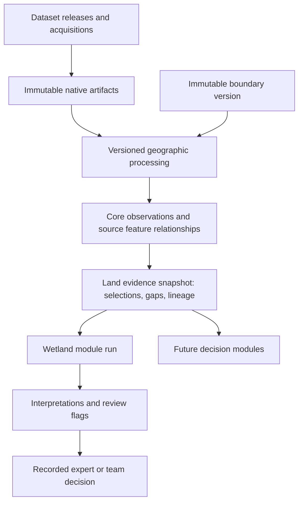

# CRC Land Intelligence / Land Evidence Foundation

Audit date: 8 September 2026. Status: architecture recommendation; no implementation or dataset acquisition in this iteration.

CRC's reusable asset should be an inspectable account of land, with explicit limits on what each source establishes. Wetland screening should consume that account. The existing system has strong acquisition and replay foundations, but its observation names, coverage semantics and storage ownership do not yet provide a sufficiently precise cross-parcel evidence contract.

This document proposes an additive evolution of CRC Earth Schema, not its replacement with a new platform. It recommends one bounded next engineering iteration in section 11. That iteration has **not** been started.

## 1. Audit scope and evidence

Inspected the working tree based on commit `bd486c7`, including existing uncommitted frontend/documentation work. The implementation is the authority where documentation differs. This audit makes no claim about a live hosted database or current national dataset completeness.

Repository evidence:

| Concern | Implementation inspected | Supporting documentation / verification |
|---|---|---|
| Domain, variable registry, validation, selection | [earth.py](../backend/earth.py), [adapters.py](../backend/adapters.py) | [Nature Intelligence](NATURE-INTELLIGENCE.md), [nature tests](../tests/test_nature.py) |
| Boundary validation, vector geometry, database | [core.py](../backend/core.py), [import_data.py](../backend/import_data.py), [flood.py](../backend/flood.py), [migrate.py](../backend/migrate.py) | [Data](DATA.md), [verification record](VERIFICATION.md), [API/worker tests](../tests/test_crc.py), [flood tests](../tests/test_flood_import.py) |
| Native evidence acquisition and normalization | [terrain.py](../backend/terrain.py), [environment_sources.py](../backend/environment_sources.py), [open_rivers.py](../backend/open_rivers.py), [source_io.py](../backend/source_io.py), [environment.py](../backend/environment.py) | [terrain tests](../tests/test_terrain.py), [environment source tests](../tests/test_environment_sources.py), [snapshot tests](../tests/test_environment_pipeline.py) |
| Features, model, execution, exports | [derived.py](../backend/derived.py), [wetland.py](../backend/wetland.py), [nature.py](../backend/nature.py), [api.py](../backend/api.py), [worker.py](../backend/worker.py) | [implementation plan](WETLAND-IMPLEMENTATION-PLAN.md), [iteration report](WETLAND-ITERATION-REPORT.md), [real model tests](../tests/test_real_model.py) |
| Real records, benchmark isolation | [verification script](../scripts/verify_real_parcels.py), [benchmark.py](../backend/benchmark.py) | [real verification](REAL-VERIFICATION.md), [machine-readable results](real-verification-results.json), local retained `data/verification/england-real-v1-final/*-after.json` |
| Evidence presentation dependencies | [site-evidence.ts](../app/site-evidence.ts), [nature-panel.tsx](../app/nature-panel.tsx) | [Stage 2](UI-STAGE-2.md), [README](../README.md) |

Read-only checks in this audit reproduced all 12 retained final real-site model results exactly using `run_wetland(saved_state, saved_spec)`. All observation parents resolved to observations and all raw references resolved to raw records. This is saved-state/model replay, not a new national acquisition or proof that every original remote byte remains available. Three isolated validator probes confirmed that the current schema accepts a dangling parent reference, an arbitrary category string, and a non-null observation with zero input coverage. Those are contract gaps, not evidence that the verified records are corrupt.

Validation completed for this documentation audit: the existing Python suite passed **98 tests** on its isolated SQLite test database, with 13 dependency deprecation warnings. The inventory tables were checked programmatically against all 38 registry entries, and local document links resolve. PostgreSQL, new live acquisition and hosted deployment were not rerun; earlier reports' PostGIS results remain historical verification claims.

External primary-source catalogue and access information was checked for the gap analysis below. No account was created, licence accepted, source connected, or environmental measurement invented.

## 2. What CRC actually knows today

### 2.1 Connected, missing and merely registered are different

`earth.VARIABLES` contains **38** registered concepts:

- **17 source-backed field definitions** can receive values through current production adapters. Four overlay adapters produce three of these definitions because both woodland inventories map to the same field.
- **4 explicit unconnected inputs** are emitted as null observations by the environmental adapter.
- **5 CRC feature indices** are computed or emitted as unknown by the wetland feature layer.
- **12 other registered concepts** have no connected production observation producer.

The 12 retained real-site states each have **16 selected non-null source-backed fields**: the ancient-woodland-derived field is unknown at all 12. Each also has one non-null CRC feature, the water-context index. These counts describe field values, not independent measurements: seven terrain summaries share a DEM and four land-cover fields share one classification.

The wetland model uses only a subset. Each real example has **5/10 available required inputs**, or **5/11 including optional habitat proximity**. The missing required inputs are soil drainage, actual wetland extent, wetland condition, infrastructure and the broad irreplaceable-habitat input. A complete source field count cannot substitute for this module-specific sufficiency check.

CRC additionally knows the submitted geometry, site identity, boundary version, submitted site name, projected area and source-specific intersection geometries. It does not know legal ownership or cadastral correctness from a submitted polygon. It has no canonical catchment, administrative membership, surrounding-habitat inventory, or measured functional connectivity.

### 2.2 Source and acquisition profiles

The profile IDs below resolve metadata shared by every row in the inventory. Together, the profile and field tables specify source, provider, dates, resolution, acquisition, calculation, missingness and lineage without repeating large objects.

| Profile | Dataset / provider | Native support and dates actually retained | Acquisition and raw lineage |
|---|---|---|---|
| **T** | EA LIDAR Composite DTM 1m / Environment Agency | EPSG:27700, 1m horizontal spacing; elevations above Ordnance Datum Newlyn. Survey date unknown, composite of multiple surveys. `source_version` is the parcel TIFF SHA-256, not a named national release. | Official WCS DescribeCoverage XML and bounded GetCoverage TIFF. Request integer-aligned bounds plus 3m halo; retain original response bytes. TIFF/XML raw records → each terrain summary; method `crc_ea_dtm_horn_v1`. |
| **R** | OS Open Rivers / Ordnance Survey | EPSG:27700 lines, generalized mapping scale 1:15,000–1:30,000 in limitations; numeric resolution null. Existing verification documents April 2026 release; normalized records do not expose a structured release date. Field survey date unknown. | Official OS downloads API, GB GeoPackage ZIP, API manifest and extracted GeoPackage retained. Size/MD5 checked against manifest and local SHA-256 retained. All three artifacts → each river statistic; method `crc_os_worldcover_v1`. Observation version is the first artifact's checksum (ZIP). |
| **L** | ESA WorldCover 2021 v200 / European Space Agency | Native EPSG:4326 grid, nominal 10m; reference period 2021. `timestamp=2021-01-01` denotes the start of that year, not a one-day survey. Observation version is subset TIFF SHA-256; product release appears in dataset name. | Public COG range reads, original class values saved in a lossless native-pixel window. Remote tile URL retained as asset URL; saved subset is not original full COG bytes. TIFF → four parcel summaries; method `crc_os_worldcover_v1`. |
| **F** | Flood Map for Planning, present-day Flood Zones 2 and 3 combined / Environment Agency | Polygons requested in CRS84, measured in EPSG:27700. Effective resolution and observation date null. Import UUID is version; provider/page timestamps in source metadata are not observation time. | EA OGC Features, exhaustive bounded pagination, IDs/counts/CRS/zone checks. Assembled original features → repaired geometry artifact/database → union/intersection finding → canonical observation. |
| **S** | Sites of Special Scientific Interest / Natural England | Notified SSSI polygons only; no SAC, SPA, Ramsar or impact-risk-zone integration. Numeric resolution and observation date null. Import UUID is version. | ArcGIS exhaustive object-ID query then batches of 100, original assembled GeoJSON and source metadata retained; repaired geometry stored separately. Same vector lineage as F. |
| **A0** | Ancient Woodland, legacy inventory / Natural England | Inventory polygons; local completeness and observation date unknown. Map scale not structured in EarthState; do not invent numeric resolution. Import UUID is version. | Same ArcGIS import/repair chain. Separate finding/raw version; provider priority 50 at initial normalization. |
| **A1** | Ancient Woodland, revised inventory / Natural England | Completed counties only; CRC does not establish which inventory is authoritative for each county/parcel. Date and numeric resolution null. Import UUID is version. | Same import/repair chain. Separate finding/raw version; provider priority 100 initially. Both candidates retained. |

All sources retain acquisition time independently of observation time. T/R/L acquisition caches hold more information than the final EarthState, including requests and processing diagnostics. The public source links, attribution and recorded OGL/WorldCover CC BY 4.0 terms are in [Nature Intelligence](NATURE-INTELLIGENCE.md) and [Data](DATA.md). Current Earth `RawSource` does **not** provide structured licence fields.

Coverage is source-specific. F is restricted to `[-1.33, 51.72, -1.22, 51.82]`; S/A0/A1 use `[-1.65, 51.50, -0.85, 52.05]`. These are extract rectangles, not administrative boundaries or ecological completeness footprints. A vector value is produced only if the entire parcel is covered by the extract and the dataset is available. T is limited by actual WCS availability and the 25-million-cell bounding-box budget. R uses GB source data and a 5km local search. L currently rejects parcels crossing a 3° source tile boundary and windows above 10 million cells. The application assumes England; its coordinate bounding box is not an actual England country-polygon test.

### 2.3 Exact inventory of currently source-backed fields

Every field below is **derived** from a native raster/vector; none is a direct field-survey measurement. All are reusable core facts once their source scope and support are explicit. “Wetland use” describes today's consumer, not ownership of the fact.

Missingness codes:

- **MT:** failed/unsupported DEM → null with reason; otherwise statistics on valid parcel cell centres. Elevation and slope have separate valid-cell fractions. No valid relevant cells → null.
- **MR:** acquisition failure → null. A complete mapped-network query can establish “no intersection” and zero 100m overlap. Exact nearest distance remains null when none is established within 5km; this is not zero distance or absence of all water.
- **ML:** failed/unsupported raster → null. Nodata class 0 excluded from value denominator; valid-class coverage retained. Non-null fractions describe valid sampled area, not necessarily the whole parcel.
- **MV:** unavailable dataset or not wholly inside extract → null. Covered empty polygon overlap → numeric zero, limited to that layer.
- **MA:** MV plus zero ancient-woodland overlap becomes null in the canonical broad habitat field because completeness is unestablished. The underlying inventory finding still retains the measured zero.

| Canonical field exactly as implemented | Conceptual category | Profile; units | Calculation / spatial meaning | Missingness | Wetland use; future reuse |
|---|---|---|---|---|---|
| `terrain.elevation_m` | Physical / elevation mean | T; m ODN | Arithmetic mean of valid native centres in polygon including holes | MT | Context only; core |
| `terrain.elevation_min_m` | Physical / elevation minimum | T; m ODN | Minimum of same valid elevations | MT | Inspectable context; core |
| `terrain.elevation_max_m` | Physical / elevation maximum | T; m ODN | Maximum of same valid elevations | MT | Inspectable context; core |
| `terrain.elevation_std_m` | Physical / elevation spread | T; m | Population SD, `ddof=0`, of valid elevations | MT | Inspectable context; core |
| `terrain.slope_deg` | Physical / slope mean | T; degree | Horn 3×3 slope at parcel centres, arithmetic mean; requires nine valid neighbourhood cells | MT | Required physical input; core |
| `terrain.slope_p90_deg` | Physical / slope upper quantile | T; degree | Linear-interpolated 90th percentile of valid Horn slope cells | MT | Inspectable context; core |
| `terrain.slope_max_deg` | Physical / slope maximum | T; degree | Maximum of valid Horn slope cells | MT | Inspectable context; core |
| `hydrology.distance_to_water_m` | Physical / mapped watercourse proximity | R; m | Minimum distance from whole parcel polygon to complete selected line geometries, not centroid-to-water or water-surface distance | MR | Required water-context input; core |
| `hydrology.watercourse_intersection` | Physical / mapped line relationship | R; category string `yes` / `no` | Shapely `intersects`, including a boundary touch; no channel-width or interior-crossing requirement | MR | Explanatory context; core, preferably typed Boolean |
| `hydrology.within_100m_watercourse_fraction` | Physical / mapped proximity area | R; fraction 0–1 | Parcel intersection with unioned lines' round 100m buffer / EPSG:27700 parcel area | MR | Explanatory context; core; not observed wetness |
| `land_use.current_cover` | Ecology / mapped dominant cover | L; category | Class with greatest valid geodesically weighted cell area; ties by lowest source class code | ML | Required restoration-need input; core **land cover**, not current use |
| `land_use.developed_fraction` | Built / mapped built-up proxy | L; fraction | WorldCover class 50 valid-area fraction | ML | Required feasibility input and >0.5 review flag; core proxy, not footprint |
| `ecology.mapped_wetland_fraction` | Ecology / mapped herbaceous wetland | L; fraction | WorldCover class 90 valid-area fraction | ML | Context only, deliberately not substituted for actual wetland extent; core |
| `hydrology.surface_water_fraction` | Physical / mapped permanent water | L; fraction | WorldCover class 80 valid-area fraction | ML | Context only; core |
| `hydrology.mapped_flood_extent_fraction` | Physical / mapped flood context | F; fraction | Union of imported FZ2/FZ3 geometries intersected with parcel / parcel area | MV | Required water-context input; core mapped model extent, not probability |
| `regulatory.protected_area_fraction` | Designation / SSSI overlap | S; fraction | Unioned notified SSSI area within parcel / parcel area | MV | Review flag, no score effect; core **SSSI-specific** fact |
| `ecology.irreplaceable_habitat_fraction` | Ecology / known ancient-woodland overlap proxy | A0 + A1; fraction | Each inventory separately unioned/intersected; select largest positive known fraction, not sum or spatial union across inventories | MA | Required feasibility input; underlying inventory facts core; broad irreplaceability interpretation insufficiently supported |

T uses a 3m requested external halo and verifies at least one cell beyond the full parcel for slope. Native grid cells have equal planar area. In a neighbourhood `a b c / d e f / g h i`, `dx=((c+2f+i)-(a+2d+g))/(8×spacing_x)`, `dy=((g+2h+i)-(a+2b+c))/(8×spacing_y)` and slope is `atan(hypot(dx,dy))` in degrees. No resampling, filling, routing or hydrological conditioning occurs.

L's complete class distribution is retained in the acquisition statistics and repeated as JSON text inside **each observation's `method` string**. It is not a typed canonical distribution. Current codes map to `woodland`, `shrubland`, `grassland`, `arable`, `developed`, `bare_ground`, `snow_ice`, `water`, `wetland`, `mangroves`, `moss_lichen` for codes 10–100 in the adapter's explicit mapping. These are mapped cover labels, not management or habitat-condition observations.

### 2.4 Explicit null observations

All four rows below use provider `CRC`, dataset `Unconnected priority evidence`, version `crc_os_worldcover_v1`, no raw source/parents, unknown observation time/resolution, parcel support, and `retrieved_at=state.as_of`. That timestamp records creation of a gap declaration, **not acquisition of environmental evidence**. Method is `No inference or imputation`; values are null, confidence/input coverage zero, epistemic status unknown. They are emitted only when environmental enrichment runs.

| Canonical field | Category; units | Actual state / missing reason | Core versus module |
|---|---|---|---|
| `soil.drainage_class` | Physical / soil; category | No spatially appropriate authorized source connected; ordinal mapping support exists but no real populated value | Source drainage classification belongs to core |
| `ecology.wetland_fraction` | Ecology / habitat extent; fraction | WorldCover herbaceous class cannot establish complete actual wetland extent | Habitat polygons with survey definition belong to core; wetland aggregation requires an explicit habitat set |
| `ecology.habitat_condition` | Ecology / condition; normalized_index | No current ecological condition survey; cover is not condition | Survey and native assessment scale core; today's generic 0–1 wetland condition interface is module-specific |
| `human.infrastructure_fraction` | Built / footprint; fraction | No complete road, rail and infrastructure footprint inventory | Separate source footprints belong to core; “complete infrastructure” needs a declared catalogue scope |

### 2.5 Registered concepts without connected production observations

These have **no production provider, dataset version/date, acquisition method, spatial resolution, derivation or raw chain to report**. Their units are registry declarations, not verified environmental measurements. Absent observations return `None` through `EarthState.get`; some appear in wetland `missing_inputs`, but not every registry omission becomes an explicit gap. Synthetic unit/model tests do not establish source availability.

| Exact field | Category; registered units | Existing intended meaning / architecture disposition |
|---|---|---|
| `terrain.aspect_deg` | Physical; degree | Undefined parcel aggregation of circular direction; only admit after an explicit aspect statistic/support contract |
| `soil.clay_fraction` | Physical / soil; fraction | Potential reusable fact; needs depth interval, dry-mass basis and measured/modelled support |
| `soil.permeability` | Physical label; normalized_index | Not physical permeability units. Synthetic numeric input feeds `1-value`; retain as legacy model input, not a canonical measured soil property |
| `hydrology.flow_accumulation` | Physical / catchment; m2 | No routing implementation; would require contributing-area/outlet and conditioning definition |
| `hydrology.floodplain_probability` | Physical label; probability | Undefined event, horizon and floodplain meaning; never populate from flood-zone numbers or overlap |
| `hydrology.groundwater_depth_m` | Physical; m | No source. Requires sign convention, datum, time and point/spatial support before use |
| `climate.annual_precipitation_mm` | Physical climate; mm/year | No source, period or aggregation specified; contextual only in current wetland gaps |
| `vegetation.ndvi` | Vegetation; normalized_index −1 to 1 | No sensor/date/cloud/season/statistic contract; optional later, not a habitat-condition measure |
| `ecology.habitat_type` | Ecology; category | No classification vocabulary or source; replace future scalar assumptions with habitat patch/distribution records |
| `ecology.distance_to_habitat_m` | Spatial ecology; m | Wetland code means distance to relevant wetland habitat; target class set and search domain absent. Generic relation operation is core; relevance choice is module-specific |
| `land_use.agricultural_quality` | Land-use interpretation; category | No source/classification contract; not established by WorldCover cropland |
| `economic.intervention_cost_per_ha` | Economics; GBP/ha | No source/intervention/year basis; exclude from initial physical land core |

### 2.6 CRC-generated interpretations currently stored as observations

All five are `Observation` records in `EarthState.derived`, provider `CRC`, dataset `CRC derived environmental features`, version `crc_wetland_features_v0_1_1`, units `normalized_index`, derived/inferred when known. Parent observation IDs and their raw IDs are retained. Dates propagate only if available input timestamps agree; resolution is the coarsest known input spacing only when all are known. `retrieved_at=state.as_of` is computation bookkeeping, not source retrieval. These indices should belong to the wetland module.

| Current field | Exact rule / parent inputs | Missingness / limitations |
|---|---|---|
| `soil.retention_index` | `1-soil.permeability` when a numeric normalized input exists; otherwise drainage class prior: very poorly 1, poorly .85, imperfectly .65, moderately well .4, well .2, excessively 0 | Unrecognized/mixed/missing class → null. Ordinal prior is not retention capacity, conductivity or measured water supply |
| `hydrology.water_context_index` | Mean of available mapped flood fraction and `max(0,1-distance_to_water_m/1000)` | One term permits partial value; neither → null. Mixing river proximity and mapped flooding is an interpretation, not connectivity |
| `ecology.restoration_need_index` | `(1-wetland_fraction)×cover_prior + wetland_fraction×(1-condition)`; arable .7, improved grassland .6, wetland 0 | All applicable inputs required; condition omitted only for actual wetland fraction exactly zero. Other cover labels or wetland label with fraction <.95 → null. Managed-cover priors do not measure degradation |
| `ecology.habitat_proximity_index` | `max(0,1-distance_to_habitat_m/1000)` | Missing target-habitat distance → null. Neither biodiversity gain nor functional connectivity |
| `human.unblocked_area_index` | `max(0,1-developed-infrastructure-irreplaceable)` | All three required. Overlapping classes can be counted twice; absent classes can still be omitted by source inventories. Not a measured feasible footprint |

The features' quality factors are 1 or .6 for numeric/categorical soil respectively, .6 for water context, restoration need and habitat proximity, and .7 for unblocked area. Their `confidence` includes missing-input effects; it is not predictive confidence.

### 2.7 Other retained facts and separate outputs

`sites` holds org, identity, current geometry/version, name, notes, review status and creation time. Boundary submissions are stored in private object storage; `assessments` snapshots geometry, version, name and submission time. `result.area_ha` is rounded to four decimals after EPSG:27700 area computation. These are useful identity facts outside Earth observations.

Each overlay finding also holds exact `fraction`, rounded `measured` hectares, rounded `percent`, intersection geometry, dataset version, coverage, attribution and import extent. Fractions/areas are geographic facts; `category`, `interpretation` and `next_steps` are rule outputs in the same object. Original source feature attributes/IDs survive in raw snapshots but are not retained as first-class relational attributes in the `features` table, whose IDs are CRC UUIDs.

Wetland components are `physical_potential`, `restoration_need`, `hydrological_relevance`, `ecological_opportunity`, `implementation_feasibility`, plus legacy `data_confidence`. Bands and overall scores are interpretations; flags and suggested investigations are decision support. Team statuses `Unreviewed`, `Investigate`, `Hold`, `Archived` are human decisions. They are independent of model results, but currently have no append-only decision history.

EA WWNP floodplain reconnection is retained for verification only, with separate source and overlap results. It is neither a connected core observation nor wetland training/score input. Keep that boundary.

## 3. Architecture assessment

### 3.1 Strengths to preserve

1. Acquisition is outside deterministic inference. `run_wetland` can use saved state/spec without network, ambient source settings or current wall clock.
2. Original terrain responses, river archive/database/manifest, land-cover subset and pre-repair vector snapshots have meaningful provenance and checksum references. Geometry repairs are disclosed.
3. Unknowns are generally honest. Flood zones do not become flood probabilities; mapped wetland zero does not become actual wetland absence; missing soil is not synthesized.
4. Candidate observations and deterministic selection notes are retained. Incomplete revised woodland cannot erase a known positive overlap.
5. Submitted boundary, overlay dataset IDs and model/feature/acquisition specification are pinned; saved results are read without silent recalculation. Worker DB writes have lease/fencing protection.
6. Runtime and scientific validity are explicitly separate. The existing test/verification investment is useful migration protection, even though it does not validate restoration outcomes.

### 3.2 Weaknesses and technical debt

| Priority | Finding and implementation evidence | Consequence / recommendation |
|---|---|---|
| **P1** | Source-specific summaries are named as general land truths: SSSI→`protected_area_fraction`; ancient woodland→`irreplaceable_habitat_fraction`; 2021 dominant cover→`current_cover`; watercourse lines→`distance_to_water_m` | This is the central weakness. Two future adapters can populate the same name with different meanings while satisfying today's validator. Define concept versions, source classification, denominator and support contracts before expansion |
| **P1** | `EarthState.derived` contains only wetland heuristics, while genuine derived geography is in `normalized`; `nature.assess_nature` always calls wetland features before dispatch | “Derived” does not separate facts from interpretations. Put algorithmic geographic observations in core; module features/results in separate runs |
| **P1** | Evidence is owned by `assessments.result.environmental_state` and an assessment-path environmental snapshot. Only legacy vector imports appear in `datasets` | There is no independently reusable evidence snapshot/catalogue spanning all sources. Add an evidence snapshot identity; keep legacy results intact |
| **P1** | `input_coverage` represents raster valid-cell fraction, mean parent support and, indirectly, component weighted input availability | A single number cannot establish spatial completeness, thematic completeness or model readiness. Separate all three |
| **P1** | Ancient-woodland positive overlap gets default `input_coverage=1`, despite incomplete broader irreplaceable-habitat scope | Positive evidence is valuable, but cannot certify that all irreplaceable habitat was checked. In future contracts it is a bounded mapped inventory fact. The legacy feasibility formula is not a guaranteed conservative bound on real feasible area when source omissions exist |
| **P1** | T/R/L are resolved at execution/cache time, while overlay UUIDs are pinned at submission. Cache keys use geometry/processor, not a cohort-wide source release. Cached available acquisitions have no expiry | Saved jobs are reproducible but separate parcel jobs can use different vintages. Resolve and pin a shared evidence release manifest for comparative work |
| **P2** | WorldCover class proportions are repeated inside method prose; numerical grid spacing is not checked against the expected native WorldCover spacing | Distribution querying and schema-change checks are weak. Preserve typed class rows, grid identity and structured parameters. Documentation's broad claim that unsupported grids are rejected exceeds the present checks |
| **P2** | EarthState has no graph-level validation of unique IDs, selected references, typed parent/raw edges, cycles, or mandatory raw artifacts for acquired facts | Verification scripts catch dangling references, but arbitrary API/domain callers need stronger commit-time invariants. Missing-source declarations should be typed gaps, not pretend sources |
| **P2** | IDs use different schemes: import UUID, artifact checksum, or fingerprints of value/parents/site. Many omit metadata; `derived` IDs omit `as_of` even when quality changes with it | Do not use current observation IDs as globally unique immutable relational row identities. Keep legacy ID and full payload hash; scope imported IDs to snapshot |
| **P2** | `source`, `source_version`, `timestamp`, `spatial.crs`, `confidence` overload provider identity, asset identity, date and quality meanings | Separate dataset release from artifact digest, observation period from retrieval and computation, source CRS from support/processing CRS, quality from confidence |
| **P2** | `enrich_state` rebuilds existing candidate priorities as 100; retry imports do the same. Special woodland selection still retains greatest positive overlap | Registry precedence is not a durable selection record through all stages. Persist policy/version and actual ranked candidates; do not infer provider precedence from checksum sort order |
| **P2** | Raw files are content-addressed locally, but generic `store_object` overwrites keys; the assessment `snapshot.json` write is not protected by the DB fencing token or conditional object creation | Existing completed snapshots replay correctly; this is a code-inspection race risk before snapshot completion. Add immutable commit manifests and compare-and-set publication when persistence evolves; DB fencing alone does not protect an object path |
| **P2** | `EarthState.get` always prefers `derived`; category validation accepts any string; defaults can imply full coverage | A future core observation can be silently shadowed by a heuristic. Enforce namespace/record-kind contracts and explicit support for new records |
| **P2** | Vector normalization points directly to original raw ID; repaired artifact/checksum and individual contributing feature IDs are not graph nodes | Original data is inspectable, but automatic reconstruction of a specific overlay requires external conventions. Promote repair/process runs and feature references |
| **P2** | Job `completed/partial` is based only on old overlay `completeness/dataset_count`; report `data_coverage` counts all scored slots while main UI uses required slots | Operational completion is not evidence completeness. Give counters explicit names and denominators; preserve historical labels in legacy views |
| **P2** | Frontend `observationState` labels any derived observation `modelled`, including deterministic terrain summaries | Derivation method and knowledge type need separate fields that consumers can render consistently; no UI work is required in this iteration |

Metadata availability also differs between caches and immutable evidence. DEM cell counts, requested bounds, affine transform and some request headers remain in mutable cache manifests or are reconstructible from TIFFs, rather than being consistently exposed through EarthState. OS release information can be inspected through archive metadata but is not a normalized release record. Raw artifact accessibility and rights should resolve directly from a committed evidence snapshot, without requiring a cache to survive.

Documentation drift: the final README still says distance inputs are not retrieved, although OS acquisition now implements them. Earlier documentation prioritizes LandIS as the next wetland improvement; this foundation audit recommends a semantic contract first. Neither historical verification reports nor earlier saved assessments should be rewritten to match a later architecture proposal.

## 4. Canonical land evidence domain

### 4.1 Principles and boundaries

A canonical observation is a precisely defined claim about a spatial support, produced from identified evidence using a recorded method. It may be a measured value, a mapped classification, a published model output or a deterministic geographic calculation. A derived slope is still core evidence; a weighted wetland potential is a module interpretation. A mapped flood model can be evidence about a published map without becoming an observed flood event.

Use a small typed domain over the existing Python/SQLAlchemy/PostGIS/object-storage stack. Avoid a universal environmental grid, universal score, generic graph database, new microservice, or exhaustive registry of empty categories.



No arrow runs from a model's desired score back into evidence selection. Benchmarks stay outside scoring unless a future separately justified model version explicitly changes their role.

### 4.2 Recommended entities and ownership

These are logical records, not a demand to create every table immediately. Typed value/distribution tables and lineage edges can be introduced when the projection proves useful.

| Entity | Key contents / responsibilities |
|---|---|
| `LandParcel` | Stable org-scoped identity, human name and notes; points to current boundary. Identity is not legal title |
| `BoundaryVersion` | Immutable submitted geometry artifact, normalized geometry, original and normalized hashes, version, source/declared purpose, validation method, accepted time, area measurement and jurisdiction support. Org-scoped; never silently repair |
| `Dataset` and `DatasetRelease` | Stable provider/product IDs, title, catalogue URL, geography, source vocabulary, declared resolution/scale, release/version/date, valid/reference period, known survey-date ranges, licence/attribution and access scope. Unknown publisher release ID remains null; release manifest hash supplies CRC identity |
| `Acquisition` | Dataset release reference, request/query envelope and parameters, started/completed times, HTTP/source metadata, status/reason, exact acquired coverage, completeness checks and artifact memberships. Empty successful result differs from failed acquisition |
| `Artifact` | Content digest, private object key, bytes/media type, roles, original-response versus assembled versus native-subset versus repaired/derived status, grid/CRS/extent metadata. URL is origin, not immutable identity; artifact access is licensed and org-authorized |
| `ProcessingRun` | Processor ID/version, parameters, boundary/support reference, exact artifact/observation inputs, runtime/dependency/PROJ-grid manifest, computed time, outputs and diagnostics. Geometry repair is a recorded processing step |
| `ObservationDefinition` | Versioned concept ID, plain definition, value type, unit, vocabulary, statistic, denominator/support requirements, admissible evidence kinds and absence rules. This is the core semantic contract |
| `Observation` | Definition version, typed value or distribution reference, support, availability and reason, coverage, process/acquisition references, observation-period override only when needed, limitations/uncertainty specific to this result. Contains no module score |
| `EvidenceEdge` / `FeatureRelationship` | Typed parent edges (`used_artifact`, `used_observation`, `derived_from_feature`) and relations to identified source features. Relations retain target type/class set, feature/release ID, search extent, distance/intersection/overlap method and geometry |
| `EvidenceSnapshot` and selections | Boundary version, manifest of immutable releases/acquisitions/processes/observations/gaps, selection policy/version and all candidates, content hash, build time and requested as-of policy. May be partial yet committed. Reusable by multiple module runs |
| `ModuleRun` | Module ID/version/config hash, snapshot ID, explicit input bindings, applicability/sufficiency, module features, interpretations, validation status and review flags. Shares evidence without copying it as new truth |
| `DecisionRecord` | Actor/time, parcel and boundary, evidence snapshot/module run references, decision and rationale; supersedes previous decision through a new record. Human decisions are not observations |

Keep a versioned registry in code initially. Store queryable identities, values, source memberships and snapshot membership in relational tables; store full immutable manifests, native rasters, large vector extracts and reports in existing private object storage. PostGIS indexes retain geometry efficiency; SQLite remains a development/test path. An API may assemble a compact land record with links, but that response is a view over these records, not the persistence model.

Keep source feature attributes tied to their original feature IDs and release. For a mapped designation, retain the individual intersecting sites and their names/codes as relationships, plus a correctly unioned area summary where needed. Do not replace these with an unqualified “constraints=37%”.

### 4.3 Initial semantic definitions and legacy mappings

Use the following names as proposed definition IDs, versioned independently of Python field names. The registry defines the statistic and units; do not encode every source name into the concept. Dataset-specific classification is an explicit dimension. A definition plus its required dimensions is the semantic key.

| Proposed definition / dimensions | Current mapping | Contract |
|---|---|---|
| `physical.elevation.mean/min/max/stddev` | Four `terrain.elevation_*` fields | Metres, ODN vertical reference for this profile, native centre sampling, valid cells only; stddev is population |
| `physical.slope.mean/p90/max` | Three `terrain.slope_*` fields | Degrees, Horn 3×3, native 1m profile, linear quantile; never rebind a different resolution as equivalent |
| `physical.watercourse.distance_min` | `hydrology.distance_to_water_m` | Distance from parcel polygon to mapped line network; source feature set, search radius and exact-versus-censored outcome required |
| `physical.watercourse.intersects` | `hydrology.watercourse_intersection` | Boolean; declared `intersects` predicate includes touches. An interior crossing would be a distinct predicate |
| `physical.watercourse.proximity_area_fraction` with `distance_m=100` | `hydrology.within_100m_watercourse_fraction` | Exact parcel area denominator; buffer style/approximation/CRS explicit |
| `ecology.land_cover.class_distribution` with `classification=esa_worldcover_2021_v200` | Typed extraction from L statistics/method; preserve original text as lineage | Class code, label, numerator and denominator support, all class shares; zero means none in valid classified sample |
| `ecology.land_cover.dominant_class` | `land_use.current_cover` | Argmax of that distribution, not current management or habitat survey |
| `built.mapped_built_up_fraction` | `land_use.developed_fraction` | Class 50 view of same distribution; not independently measured footprint |
| `ecology.mapped_herbaceous_wetland_fraction` | `ecology.mapped_wetland_fraction` | Class 90 view; no complete-wetland claim |
| `physical.mapped_permanent_water_fraction` | `hydrology.surface_water_fraction` | Class 80 view; no permanence validation or seasonal hydrology claim |
| `physical.flood.mapped_extent_fraction` with `zone_set=[2,3]`, `scenario=present_day`, `defence_basis=ignored`, `sources=[rivers,sea]` | `hydrology.mapped_flood_extent_fraction` | Union within this specific map/scenario / parcel area. Separate zones need recomputation from retained classified features |
| `designations.overlap_fraction` with `designation_type=SSSI`, `status=notified` | `regulatory.protected_area_fraction` | Same exact SSSI fact under narrower name; no all-designations union implied |
| `ecology.ancient_woodland.mapped_overlap_fraction` with `inventory=legacy/revised` | Individual A0/A1 findings and candidate records | Inventory-specific zeros are valid mapped facts with thematic completeness unknown; recover zero from covered legacy finding, not by changing broad null to zero |

Do not create a core `irreplaceable_habitat_fraction` alias that claims completeness. Preserve the old selection as a **legacy wetland input binding** with “largest positive mapped ancient-woodland fraction; broader scope incomplete”. A future reviewed habitat-set union would have its own definition and explicit member inventories.

Raster proportions' statistical support must be part of their definitions: legacy WorldCover uses geodesic area of whole cells selected by centre, normalized over valid cells. Call that `valid_sample_area`, never `parcel_area`. A future exact fractional-cell overlay is a new processing profile and cannot silently replace the old statistic for comparisons.

### 4.4 Categories admitted later only when defensible

| Domain | Defensible future records | Admission limit |
|---|---|---|
| Physical environment | Soil map-unit relationships, drainage/wetness class distributions, texture by depth; catchment membership; mapped water polygons and flood scenarios; groundwater point observations or published models | Map association ≠ parcel measurement; groundwater needs date/datum/support; keep natural soil drainage separate from artificial drains |
| Terrain morphology | Local relief/curvature with defined scale; conditioned contributing-area products | No parcel DEM “TWI” or upstream flow claim without sufficient catchment, conditioning/outlet and edge treatment |
| Ecology / habitat | Habitat patches and classifications, PHI attributes, mapped wetlands by declared class set, field survey extents and feature-specific condition | Preserve vocabularies, survey dates and taxonomy mappings. Do not turn remote-sensing classes into survey condition |
| Built / land use | Separate building, road-surface, rail and infrastructure features; mapped use categories; declared/observed management | Centreline buffers are proximity observations, not true footprints. Ownership and use require their own evidence |
| Designations | Separate SSSI, SAC, SPA, Ramsar and relevant protected-area/constraint relationships | Boundaries establish mapping relationships, not automatic exclusions or legal clearance; different designations retain different meanings |
| Spatial context | Multi-catchment and administrative membership with area shares, specified surrounding rings, habitat/cover distributions, target-specific proximity | Parcel can straddle multiple areas. Proximity is geometry; functional ecological/hydraulic connectivity is an interpretation requiring further evidence |

These are admission rules, not commitments to populate empty schema sections. Climate time series, NDVI, costs and economic assessments are outside the first evidence-core iteration.

## 5. Observation metadata, provenance and quality

### 5.1 What belongs where

An observation should resolve all relevant metadata but not duplicate its provider's complete catalogue record.

| Metadata | Primary owner | Observation responsibility |
|---|---|---|
| Value/type/unit; statistic and classification dimension | Value on observation; unit/type/statistic requirements in definition | Typed numeric/category/Boolean value, or normalized distribution rows; registry validation |
| Source/provider, source URL, licence/attribution | Dataset/release and artifact origins | Resolve via acquisition/process IDs; multiple inputs remain visible |
| Publisher version, publication/reference dates | Dataset release | Record feature-specific temporal override only when supplied |
| Observation date / period | Source feature/acquisition or release reference period | Distinguish actual survey time, annual classification period and unknown; no retrieval substitution |
| Retrieval and computation time | Acquisition; ProcessingRun | References to both; `as_of` is requested knowledge policy, not environmental observation time |
| Native resolution/map scale/MMU/accuracy | Release defaults and artifact grid | Effective support reference and result-specific departure/limits; map scale is not a metre-resolution field |
| Spatial/vertical CRS | Boundary/support, artifact and processing run independently | Reference the support; avoid one CRS field purporting to describe everything |
| Raw / derived; knowledge kind | Artifact role; observation evidence kind | Separate `geographic_derivation` from `field_measurement`, `mapped_classification`, `published_model`, and `survey_assessment` |
| Derivation method/version/parameters | ProcessingRun and definition | References; retain original method prose during migration |
| Uncertainty and limitations | Source defaults plus result-specific qualifiers | Qualitative limitations, bounds/censoring, instrument/class accuracy if provided, structural applicability issues. Numeric uncertainty optional, never invented |
| Spatial coverage and status | Observation support plus acquisition coverage | Explicit denominator/numerator/basis and completeness dimensions, not a single overloaded confidence |
| Parents and immutable artifacts | Typed edge and artifact records | Every acquired fact must resolve to an acquisition/artifact; every derived fact must resolve to its inputs |

Lineage invariants at snapshot commit: unique scoped IDs; selected observation belongs to the correct concept/support and candidate set; typed parent references resolve; graph acyclic; no interpretation parent enters core facts; artifact hash/size checked; acquired facts have source evidence; unknowns have machine-readable reasons; active distributions use known vocabulary; units and support comply with definition. Migrated legacy records that lack metadata receive explicit `not_recorded_legacy` qualifiers, not fabricated values.

Use a separate immutable observation-record ID or complete payload digest. Preserve current IDs under `legacy_id`, scoped by the legacy assessment/snapshot. Keep a separate computational hash for caching repeat calculations; timestamps and quality-policy evaluations must not cause an old immutable observation to be overwritten.

### 5.2 Rigorous status and coverage semantics

Recommended independent fields:

| Dimension | Values / example |
|---|---|
| Acquisition outcome | `succeeded`, `failed`, `not_attempted`, `unsupported`, `access_required`; a successful empty result is still succeeded |
| Observation availability | `available`, `partial`, `unavailable`; `not_applicable` requires an explicit applicability rule |
| Reason code | `outside_acquired_extent`, `no_valid_cells`, `incomplete_inventory`, `source_unconnected`, `source_failure`, `unsupported_tile_crossing`, `processing_budget_exceeded`, `search_limit_reached`, `category_uninterpretable` |
| Spatial support coverage | Valid cell count / eligible cell count, valid sampled area / eligible sampled area, or covered parcel area / whole parcel area; always declare basis |
| Thematic completeness | `complete_for_declared_product`, `partial_inventory`, `unknown`; never equate full query coverage with complete real-world habitat mapping |
| Temporal fitness | Source reference period, survey date/range, unknown-date flag, age at comparison date, acceptable period according to use profile |
| Module sufficiency | Required/applicable/available/interpretable inputs and spatial/thematic thresholds. Derived by the module from a fixed evidence snapshot |
| Scientific model confidence | Validation status; current wetland remains `UNVALIDATED`, with no probability/interval |

Known zero is valid only for the question actually examined. A covered SSSI query with zero means no mapped notified SSSI area in this release. A successful empty mapped-network search gives false intersection and zero 100m buffer overlap, but nearest distance can only be recorded as `>5000m` with a bound or as null exact value. A covered woodland inventory with no features gives zero mapped inventory overlap and unknown broader habitat absence. Missing class coverage must not turn into undeveloped land.

For raster fractions retain `eligible_cells`, `valid_cells`, `eligible_sample_area_m2`, `valid_sample_area_m2`, class sampled areas and fraction denominator. For exact polygon overlay retain numerator and denominator in m², intersection support and covered parcel area. Never fabricate unavailable denominators during legacy conversion; mark them unrecorded unless derived again in an explicit new process from the raw artifact.

### 5.3 Review of current quality indices

Current `Observation.confidence` is a heuristic source-quality judgement: T .85, R .80, L .65, F .65, S .75, A0 .50, A1 .60. `derived.quality` multiplies non-CRC observations by a resolution factor (unknown .75; ≤10m 1; ≤30m .85; coarser .6) and an age factor (unknown .75; ≤2 years 1; ≤5 years .8; older .6 relative to saved state time). CRC features bypass further discounting and already include parent/inference effects.

The separation introduced by `evidence_summary` is useful: required availability, all-scored availability, available-evidence quality and unvalidated model confidence are distinct. But legacy `overall.confidence`, component `confidence`, and `data_confidence` still mix quality and missingness. `derive` divides quality by all requested inputs while also reporting input coverage. The same word therefore denotes different quantities at different layers.

A universal resolution penalty is also poorly founded: a generalized line network has no meaningful pixel size, an SSSI boundary is not a raster, and 1m sampling says nothing by itself about elevation error. Annual WorldCover's 1 January timestamp makes age handling reproducible but artificially precise. Numeric source judgements and correlated source reuse are not independent probabilistic evidence.

Recommendation: preserve existing calculations for old model versions; expose them as `legacy_data_support_index` and `legacy_quality_policy`. For the core record store a quality **profile**: positional/vertical accuracy when published, sampling support, class reliability where supplied, known omissions, source age, processing checks and suitability limitations. Derive any use-specific quality gate under a versioned evaluation policy. Do not average these into a universal land-quality score or convert evidence completeness into predictive confidence.

## 6. Cross-parcel consistency standards

The comparability key should include concept definition version, classification/vocabulary, statistic, support/denominator, processing profile, source release set, selection policy, temporal policy and geography. Different parcels naturally have different raw subsets and boundary hashes; those are evidence identities, not reasons by themselves to reject comparison.

| Area | Current behavior / risk | Required standard |
|---|---|---|
| Boundary identity | Valid WGS84 Polygon/MultiPolygon; no repair. Hashes depend on JSON coordinate ordering; equivalent boundaries can have different hashes | Preserve original upload and version. Add versioned canonical geometry hashing with defined ring/part ordering; do not snap/simplify geometry to force equivalence |
| Geography | England name hardcoded after a coarse coordinate guard; vector extract rectangles vary | Resolve jurisdiction through versioned geometry, allow multiple jurisdictions, record country adapter coverage and parcel support independently |
| CRS / vertical datum | Metric analysis generally EPSG:27700; WorldCover weights geodesic EPSG:4326. Installed PROJ grid choice not pinned | Pin axis order, chosen transformation pipeline and grid checksum/availability. Distinguish source CRS, support CRS, analysis CRS and ODN datum; fail or explicitly mark degraded transformation accuracy |
| Candidate geometry | PostgreSQL prefilters with `ST_Intersects` in 4326; SQLite uses bounding boxes, then final Shapely analysis in 27700 | Make candidate retrieval conservative with the same declared tolerance/envelope, and final predicates identical. Exact reprojection edge cases should have parity checks |
| Polygon clipping | Source features remain whole at import; union then parcel intersection. Area percentages are clamped; displayed area/percent rounded | Preserve whole source features and clipped derived geometry separately. Union within declared class/scenario before division; holes/MultiPolygons honored. Store full precision; audit material excursions instead of hiding geometry errors by clamping |
| Touch versus overlap | Polygon touching yields zero area; river `intersects` includes touching | Publish explicit predicates and target geometry type. Do not call touch-only a crossing or assume zero distance means flowing through the interior |
| Terrain sampling | Cell-centre mask, ≥4 centres, native 1m, population SD, full slope halo, complete 3×3 neighbourhoods | Preserve as versioned profile. Record grid origin, cell counts and valid fractions separately for elevation/slope. Small/narrow polygons need sampling adequacy flags, not 100% confidence from four cells |
| Land-cover pixels | Native COG window; centre mask; geodesic row areas for class fractions; coverage itself is unweighted valid-cell count | Record both count and area coverage. Reject changed native grid/offsets explicitly. Distinguish valid-sample fraction from parcel-area fraction; no silent replacement with `all_touched` or fractional-pixel weighting |
| Raster edges / mosaics | DEM requires halo; WorldCover cross-tile parcel unsupported | Keep current unsupported status until a versioned mosaic method is implemented. Mosaics require consistent release, native alignment, tile/nodata rules and seam tests; never round coordinates to dodge a seam |
| Resolution mismatch | 1m terrain, nominal 10m cover, generalized rivers and inventories are combined | Keep native support. Do not upsample land cover to imply 1m knowledge; compare equivalent source/method profiles and identify parcels too small for the coarsest relevant support |
| Distance / buffers | RTree envelope 5km, whole returned lines, round 100m buffers using library defaults | Record target IDs/set, exhaustive search boundary, metric, cap/join style and segment approximation. No feature within radius means censored nearest distance; later radius changes cannot silently preserve definition |
| Flood classes | FZ2/3 union discards the class split in canonical value; raw attributes survive | Keep class/scenario-specific source relationships and optionally typed per-class statistics. Never add overlapping scenario fractions or interpret them as annual probabilities |
| Overlapping habitats | Greatest positive woodland inventory fraction retained; incomplete extent can have coverage 1 | Preserve inventory observations separately. Apply reviewed supersession spatially, using county/revision completeness; any synthesized union needs its own run and source-set definition |
| Temporal mismatch | 2021 cover, mixed-year DEM, undated inventory surveys, newer river publication; `as_of` is submission | Record valid time/reference period and transaction/acquisition time separately. A current acquisition policy may include sources fetched after submission; strict historical-as-of queries must explicitly exclude later knowledge |
| Release changes | Overlay IDs pinned; T/R/L resolved per job/cache; refresh affects environmental acquisitions, not reimport of existing vector sources | Resolve a comparison manifest once, reuse release commitments across candidates, and generate new snapshots for refresh. Never overwrite past evidence. If WCS cannot guarantee a fixed national release, retain a bounded acquisition batch and label unresolved release stability |
| Missingness | Null, absent field, failure source, partial value and unrecognized category coexist | Normalize to reasoned gaps/statuses; missing ≠ zero ≠ not applicable. Preserve lower/upper bounds and thematic incompleteness |
| Selection | Highest available priority plus special woodland maximum; priority not retained as a record | Persist candidate IDs, policy version, decisions and conflict/supersession status. Do not blend sources with different definitions merely because units match |
| Numerical reproducibility | Package versions pinned in requirements, but runtime/GEOS/GDAL/PROJ execution manifest absent | Record runtime dependencies/processor hash. Saved-value replay should match exactly; native reprocessing has versioned tolerances and diagnostics. A different algorithm is a new observation |

For “100 candidate parcels”, issue a cohort comparison manifest describing the shared releases and definitions plus per-parcel exceptions. Classify each requested comparison as comparable, comparable with stated limitations, or requiring reacquisition/reprocessing. Do not compare partial physical scores based on different available terms as though they have equal support. Two “50% complete” parcels may be missing entirely different evidence.

## 7. Prioritized evidence gaps

Ranked by breadth of land-decision value, risk of a misleading shortlist and practical usefulness, not by what raises the current wetland score. Source availability is not an integration commitment. England/GB coverage below is deliberate; UK-wide use requires separate national agencies and definition reconciliation, rather than assuming Environment Agency or Natural England coverage extends everywhere.

### 7.1 Top five

| Rank / gap | Question answered | Authoritative candidates and access | Spatial quality / uncertainty | Difficulty and reuse |
|---|---|---|---|---|
| **1. Existing habitat extent, ecological value and condition** | What is actually present, what should be protected, and is there a defensible reason to intervene? | Natural England Living England 2022–23 broad habitat map; PHI; detailed client/qualified ecological surveys; SSSI feature assessments where applicable. Living England is OGL. PHI records OGL plus specific third-party attribution/CC BY terms. Survey use/export rights must accompany supplied records. [Living England guide](https://publications.naturalengland.org.uk/file/5902077556162560), [PHI catalogue](https://www.data.gov.uk/dataset/4b6ddab7-6c0f-4407-946e-d6499f19fcde/priority-habitats-inventory-england), [NE condition guidance](https://www.gov.uk/guidance/sites-of-special-scientific-interest-condition-and-assessments) | Living England uses 10m imagery and a 300m² minimum mapping unit: predicted classes, not field condition. PHI polygon detail does not establish complete inventory absence. SSSI condition can concern a notified feature across the whole SSSI, not the queried parcel; preserve its actual support/date. No wall-to-wall parcel condition measurement is established | Medium for maps; high for robust survey/condition reconciliation. **Core** survey/mapped facts across wetland, woodland, riparian and biodiversity work. Intervention need remains module interpretation |
| **2. Buildings, roads, rail and other infrastructure footprints** | Which mapped structures and uses occupy the parcel, and which apparent opportunities require site-specific review? | OS OpenMap Local and OS Open Roads for open screening context; OS Building Features and Transport Features from NGD for more detailed licensed data. Open products use OGL; NGD commercial display/derived-data/export rights require applicable licence, not just trial access. Utilities require additional asset-owner evidence. [OS OpenData](https://www.ordnancesurvey.co.uk/products/open-data), [NGD access](https://docs.os.uk/osngd/introduction-to-os-ngd/os-ngd-explained), [Building Features](https://www.ordnancesurvey.co.uk/products/os-building-features), [Transport Features](https://www.ordnancesurvey.co.uk/products/os-transport-features) | OpenMap Local is generalized street-level mapping, not a guaranteed complete engineering footprint; Open Roads/network lines have no implied width. Detailed feature geometry still does not establish utilities, access rights or future availability | Medium for open mapped features; high for a declared complete footprint bundle and rights. **Core**, useful across all listed modules. Footprint fractions and proximity buffers must remain separate |
| **3. Soils, natural drainage/wetness, texture and peat context** | What soil associations and drainage limitations are mapped, and where is a soil investigation needed? | Cranfield/Defra LandIS, Soilscapes and appropriate NATMAP wetness/texture products. Cranfield announced free portal access on 28 April 2026; repository access inspection records free registration/EULA and no account. Product-level rights and authenticated availability still require verification, especially retention/export. [Announcement](https://www.cranfield.ac.uk/press/news-2026/uks-national-soil-database-goes-open-access), [Soilscapes specification](https://www.landis.org.uk/data/nmsoilscapes.cfm), [recorded access review](SOIL-DATA-GAP.md) | Soilscapes is 1:250,000 regional mapping. Association percentages and drainage descriptions cannot be asserted as parcel measurements. Natural drainage is not artificial drain location, conductivity or observed groundwater. Observation dates may be unknown | Medium; category mixtures, map units and licences are the hard part. **Core** across wetland, woodland, floodplain, riparian and habitat investigation. Wetland retention priors remain module-specific |
| **4. Complete declared designation/inventory coverage** | Which named designations and known sensitive habitat inventories intersect the land or its relevant surroundings? | Expand coverage of existing SSSI/AWI, resolve AWI revised-area completeness, then Natural England SAC, SPA, Ramsar and relevant protected-area datasets. Catalogues supply downloadable/API geometry and licence terms; SPA/Ramsar identify OGL and exclude proposed sites. [SAC](https://www.data.gov.uk/dataset/a85e64d9-d0f1-4500-9080-b0e29b81fbc8/special-areas-of-conservation-england), [SPA](https://www.data.gov.uk/dataset/174f4e23-acb6-4305-9365-1e33c8d0e455/special-protection-areas-england), [Ramsar](https://www.data.gov.uk/dataset/67b4ef48-d0b2-4b6f-b659-4efa33469889/ramsar-england) | Detailed mapped boundaries, no single interchangeable resolution. Catalogue dates need not be source survey dates. AWI completeness and other irreplaceable habitats remain separate from statutory designation coverage | Low/medium geometry integration; medium/high semantic completeness. **Core** across all modules. Preserve individual designations and review implications; no automatic exclusion rule |
| **5. Catchment, flood and water-system context beyond parcel adjacency** | Where does the land sit in the water system, what published pressures/flood scenarios apply, and what hydrological evidence is still needed? | EA Catchment Data Explorer catchments/water-body IDs/classifications; broader coverage of existing Flood Zones; EA Risk of Flooding from Surface Water; later authorized local drainage/culvert/asset records. API supports GeoJSON and classification downloads; check dataset-specific OGL/attribution. [CDE API](https://environment.data.gov.uk/catchment-planning/api/docs), [CDE use/licensing](https://environment.data.gov.uk/catchment-planning/help/usage), [RoFSW guidance](https://www.gov.uk/government/publications/flood-risk-maps-for-surface-water-how-to-use-the-map/risk-of-flooding-from-surface-water-understanding-and-using-the-map) | Catchment polygons are reporting/spatial context, not proof of an on-parcel drainage route. Surface-water mapping is modelled with variable source/model support and generalization; retain scenario/resolution from the chosen product, not a guessed universal number | Medium for context/broader coverage; high for conditioned routing and local infrastructure. **Core** facts serve floodplain, wetland, riparian and woodland planning. Hydraulic connectivity and intervention response remain module/expert work |

No one of these purchases or integrations would make overall restoration ranking scientifically validated. In particular, a habitat map can improve what is mapped while actual condition remains unavailable. The top ecological gap therefore includes a repeatable way to retain authorized expert survey evidence, not an invented national condition layer.

### 7.2 Useful subsequent gaps, outside the next iteration

| Gap | Source / access / support | Value and disposition |
|---|---|---|
| Administrative and landscape context | OS Boundary-Line is in the OGL OpenData portfolio; polygon geography/version and multi-membership must be retained. [OS catalogue](https://www.ordnancesurvey.co.uk/products/open-data) | Low integration difficulty; reusable core context for routing investigation and joining local priorities. Lower shortlisting impact than habitat/footprint gaps |
| Surrounding cover/habitat and structural connectivity | Reuse a licensed broader cover/habitat extract under explicitly sized buffers/rings and target taxonomies | Medium processing effort, no necessary new provider. Core distributions/distances; species-specific or functional connectivity is module interpretation. Boundary/extent omissions matter as much outside a parcel as inside |
| Recent cover and verified current management | UKCEH annual Land Cover Maps include 10m products; current commercial/product rights require verification. Client management records and qualified site observations remain necessary. [UKCEH products](https://www.ceh.ac.uk/data/ukceh-land-cover-maps), [2024 map description](https://www.ceh.ac.uk/news-and-media/news/explore-how-land-cover-varies-between-different-parts-uk) | Medium for mapped cover; high for dependable management histories. Core evidence with dates. A newer cover map is not automatically current use or improved/degraded grassland |
| Geology, aquifer context and groundwater | BGS permeability maps describe geological-unit classes at 1:50,000 and are premium/licensed. Borehole/gauge/survey data need point/date/datum and access checks. [BGS product](https://www.bgs.ac.uk/datasets/permeability/), [hydrogeological mapping](https://www.bgs.ac.uk/groundwater/data/hydrogeological-maps/) | Medium/high; reusable core geological/point facts. Rock permeability is not soil conductivity; aquifer presence is not parcel groundwater depth. Groundwater-response modelling remains separate |
| Seasonal water supply, hydroperiod, water quality, artificial drainage and barriers | CDE published water-body evidence plus appropriately located/time-stamped monitoring, drainage-authority/landowner records and field investigation; rights and completeness vary | High integration/interpretation difficulty. Core raw observations, with explicit point/network support; module-specific sufficiency. Required before confident intervention design, not mandatory national ingestion to begin land inspection |

Do not expand to economics, tenure acquisition or universal opportunity scores as a substitute for these physical evidence gaps. Retain user-supplied ownership/access information as declared evidence when relevant, without treating the boundary as proof.

## 8. Representative parcel intelligence record

The following is a **proposed relational projection of a real retained result**, not a migrated database record or fabricated parcel. Short IDs such as `O-slope` and `E-PM` below are explanatory aliases; full current artifact/version identities are supplied separately. Unknown values remain unknown.

### 8.1 Identity and snapshot

| Record | Representative values |
|---|---|
| Parcel | `verification-port-meadow`; “Port Meadow with Wolvercote Common & Green”; public SSSI reference geometry, not an ownership boundary |
| Boundary | Version 1; [reference geometry](port-meadow-reference.geojson); stored WGS84 polygon; computed area 167.1509 ha under existing EPSG:27700 method |
| Legacy state | `crc_earth_v0_1`; as-of/submission `2026-09-08T14:50:39.030617Z`; geography `England` (legacy assumption) |
| Proposed snapshot `E-PM` | References boundary, source memberships, core observation rows, selection records and gap rows. Records legacy source-result hash; no invented snapshot creation date or source release |

### 8.2 Core observations and relationships

Rounded values below are for reading; the projection retains original floating-point values.

| Alias | Definition / support | Value | Provenance and limits |
|---|---|---:|---|
| `O-elev` | Elevation mean; valid native parcel centres | 57.52826672018964 m ODN | T acquisition; valid-cell fraction 1; local survey dates unknown |
| `O-elev-range` | Separate min/max/SD rows | 56.41999816894531 / 64.02300262451172 / 0.4074544584566345 m | Same DEM, not independent confirmations |
| `O-slope` | Mean Horn slope | 1.1761786447140652° | T processing; valid-slope fraction 1 |
| `O-slope-upper` | Separate p90/max rows | 2.5424023775252182 / 50.85756435297158° | Local high slope does not invalidate the mean; investigate banks/artefacts in native terrain |
| `O-river-distance` | Parcel-to-mapped-line minimum | 0 m | R query; exact within 5km search |
| `O-river-hit` | Mapped line intersects, including touch | true | Legacy value `yes`; no assertion of hydraulic connectivity |
| `O-river-near` | Within 100m buffer / exact parcel area | 0.23374059410448156 | R; round-buffer geometry |
| `O-flood` | FZ2/3 combined union / parcel area | 0.9703827262282114 | F; present-day river/sea map ignoring defences |
| `O-cover` | Dominant WorldCover class | 30 / grassland | L; annual 2021 classification, valid sampled coverage 1 |
| `O-built` | WorldCover class 50 / valid sampled area | 0.0007011924048548014 | L; 0.0701%, not complete building/infrastructure footprint |
| `O-herbaceous-wetland` | WorldCover class 90 / valid sampled area | 0.008927013348618083 | L; 0.8927%, not actual wetland extent |
| `O-water` | WorldCover class 80 / valid sampled area | 0.00035064447282728297 | L; mapped permanent water class |
| `O-sssi` | Notified SSSI union / parcel area | 0.9999999999999987 | S; effectively 100% after display rounding, separate named-site relation desirable |
| `O-aw-legacy`, `O-aw-revised` | Covered inventory-specific mapped overlaps | 0 in retained findings | A0/A1; broad legacy `irreplaceable_habitat_fraction` stays null. A zero mapped inventory result does not establish habitat absence |

The cover distribution belongs in child rows keyed by `(observation_id, classification_id, class_code)`, rather than repeated method text. The existing summary provides all class fractions; the three class-specific fraction rows above are views of the same source distribution. Soil/drainage and groundwater remain gaps, not blank zero-valued physical rows.

One observation could be serialized as this small record. It references shared records instead of embedding all source metadata; the IDs are the explanatory aliases used in this example.

```yaml
observation_id: O-slope
definition_id: physical.slope.mean
definition_version: 1
value:
  number: 1.1761786447140652
  unit: degree
support_id: PM-boundary-v1-native-DTM-centres
evidence_kind: geographic_derivation
availability: available
coverage:
  basis: valid_slope_centres_over_eligible_parcel_centres
  fraction: 1.0
processing_run_id: PM-horn-v1
acquisition_ids: [PM-T-acquisition]
quality_profile_id: PM-T-quality
result_limitations:
  - Local source survey dates unknown
  - No hydraulic connectivity inferred
```

`PM-horn-v1` resolves to `crc_ea_dtm_horn_v1`, the boundary, T DEM/XML and native grid; `PM-T-acquisition` resolves to the retained retrieval time and artifact digests below; `PM-T-quality` preserves the source-quality judgement as a heuristic with no numeric predictive uncertainty. The snapshot membership table associates `O-slope` with `E-PM`. Observation time resolves as unknown through T, rather than being assigned the acquisition date.

### 8.3 Provenance memberships

| Alias | Actual retained identity / dates |
|---|---|
| T DEM | SHA-256 `b386dd3e503a90bfe14c8a101c306485b8516597871e434e9669e7c5de60b43e`; retrieved `2026-09-08T14:23:24.261082Z`; raw object `environmental/raw/<digest>/<digest>.tif` |
| T metadata | SHA-256 `9f97049361979d188051bea7647039151cb74dcb68753b67be3d892c091de958`; same acquisition, XML raw object |
| R | ZIP SHA-256 `b31e85f9fd412a48f61012c3945e9a60e284cab9f9fb7c49fa54c3cfc6c7053e`; GeoPackage SHA-256 `81fbe8d88396a8d45ab29a9ee14468aa41a325c57fe68d16e9b48ed06daa0644`; retrieved `2026-09-08T14:24:15.133261Z`; API manifest also retained |
| L | Subset SHA-256 `105283ecb0ac75db47a6f66ab1d48c383d52ec8694644efb8975d40baa04f32c`; retrieved `2026-09-08T14:27:22.974743Z`; product 2021 v200; annual observation period reconstructed explicitly from documented source semantics |
| F | Import UUID `f877fc6b-de26-4085-a244-4cbcf1877c2f`; retrieved `2026-09-07T21:07:03.538651Z`; `reference/<uuid>/source.json`, with metadata and normalized geometry siblings |
| S | Import UUID `f8db9506-196a-4feb-8c30-076583692118`; retrieved `2026-09-07T14:51:45.483168Z` |
| A0 / A1 | `1c76a51d-0bce-4383-8c73-6a2d5580bc46` / `723fd232-5708-49d1-baf9-4dcc0b0f4f7f`; retrieved `2026-09-07T14:51:16.861785Z` / `2026-09-07T14:51:43.829560Z` |

The complete 12-site evidence and original IDs are retained in [real-verification-results.json](real-verification-results.json). Artifact hashes identify content; they do not supply a publisher release date. Old vector UUIDs must resolve to their actual raw checksum rather than be relabelled as hashes.

### 8.4 Gap, context, interpretation and decision records

| Record family | Representative entries |
|---|---|
| Missing physical | Soil drainage `source_unconnected`; groundwater `source_unconnected`; catchment flow routing `source_unconnected` |
| Missing ecological | Actual wetland extent and habitat condition `source_unconnected`; full irreplaceable-habitat inventory `incomplete_inventory`; relevant-habitat distance absent |
| Missing built/designation | Complete infrastructure footprint absent; SAC/SPA/Ramsar not connected. No claim that the parcel has no such designation |
| Missing context | Catchment membership, administrative geography and surrounding habitat/cover not computed; no guessed Oxford catchment ID from the site name |
| Wetland interpretation | Module `wetland_restoration_v0_1`, feature version `crc_wetland_features_v0_1_1`; water-context index 0.9851913631141057; physical band `VERY_HIGH`, partial coverage .70; overall `INSUFFICIENT_DATA`; model confidence `UNVALIDATED` |
| Decision support | Habitat/condition and hydrological investigation required; protected-site review. These are suggested actions referenced to the module/evidence |
| Human decision | None is asserted for this verification parcel. A later team's “Investigate” record would include actor/time/rationale and snapshot/run references |

The practical land-record API can return identity, selected evidence summaries, gap counts by requested evidence profile and references to these records. It should offer expandable source/feature/distribution records rather than copying entire raster manifests into every observation.

## 9. Core evidence and the wetland module

The wetland implementation can become a module with an incremental compatibility boundary. It already consumes `EarthState` rather than making provider network calls inside scoring. It is **not yet cleanly modular at orchestration, feature ownership or persistence**.

Keep existing `run_wetland`, thresholds, weights, completeness gates, ordinal priors and model signature behavior unchanged during migration. The module's physical weights remain .35 slope / .30 retention / .35 water context; final weighting .70 physical / .20 hydrological / .10 ecological before need/feasibility scaling. This audit does not endorse scientific validity of those choices or redesign them.

Target interface:

```text
build_land_evidence(boundary_version, evidence_profile, release_manifest)
    -> EvidenceSnapshot

run_module(module_spec, evidence_snapshot, input_binding_version)
    -> ModuleRun

record_decision(actor, evidence_snapshot, module_run?, decision, rationale)
    -> DecisionRecord
```

`evidence_profile` describes requested observations and admissible acquisition geography, independent of model scoring. It is not a universal list of every possible environmental variable. The wetland module declares its own requirements, target habitat definition, acceptable support and legacy bindings. Future modules may request evidence additions through profiles, but cannot redefine an existing observation to suit their scoring.

The first bridge reads legacy states/results into a precise core projection. A later compatibility adapter can bind that projection back to the **unchanged legacy input contract**, including known limitations. Do not populate old `ecology.wetland_fraction` from a new mapped habitat product merely to satisfy a gate. More rigorous future sufficiency rules require a new module/binding version and new assessment, not retroactive edits.

Historic results remain authoritative records of what CRC computed then. Reports currently combine saved findings with an explicitly labelled **current** team decision at export; that is not immutable historic decision history. A future decision log should distinguish decision-at-assessment, later decisions and present status without altering saved model evidence.

## 10. Commercial usefulness: 100 candidate parcels, 10 investigations

The proposed foundation would support a defensible evidence-first shortlist: assemble the same requested facts, identify material conflicts and gaps, explain why expert investigation is warranted, and show which records are actually comparable. It would also reduce repeated desk research by reusing source acquisitions, typed observations and provenance across decisions.

CRC today can help inspect terrain, mapped water proximity, dated cover and a few inventory intersections within the connected coverage. Osney Mead illustrates its value: plausible physical water context coexists with roughly 99.3% mapped built-up cover. Port Meadow illustrates the opposite limitation: low slope and mapped flooding coexist with valuable habitat whose current restoration need is not established.

CRC cannot yet convincingly choose the “best 10 restoration opportunities” from 100 arbitrary English parcels. All 12 retained examples lack an overall result. The largest blockers are:

1. Existing habitat/condition and incomplete sensitive-habitat evidence: high physical potential could identify land that should be protected rather than converted.
2. Incomplete infrastructure/current-use evidence: low mapped built-up fraction can miss an operational car park or infrastructure conflict.
3. Missing soils and water-system context: apparent wetness/proximity does not establish persistent water supply or suitable soil/hydrology.
4. Unequal coverage and release/support semantics: corridor-only flood coverage, regional inventories, raster seams and differing acquisition vintages can bias apparent comparisons.
5. No independent validation of the current model's predictive or prioritization performance. Complete inputs alone would not close this gap.

Until those are addressed, “10 deserving expert investigation” should be a documented expert triage decision with explicit uncertainty and selection rationale, not an automatically claimed restoration ranking. Unknown parcels should enter an evidence-acquisition/review queue rather than drop to the bottom as low-potential land. Comparative runs need a coherent evidence manifest even before any comparison UI is expanded.

Evaluate the commercial foundation with consenting expert users against their current desk-research workflow: time per parcel, proportion of claims traceable to source, corrections after review, missed material constraints, reasons for requesting further evidence and whether the investigation shortlist changes. Predictive validation would need separate independent outcome/field evidence. Do not use the same 12 illustrative sites to calibrate and claim validation.

## 11. Incremental migration and single next implementation

### 11.1 Migration path

| Stage | Change | Preservation / exit condition |
|---|---|---|
| **1 — next bounded iteration** | Versioned core observation definitions and a read-only legacy evidence projection/validator | Existing observations, gaps and heuristics correctly separated with no acquisition, DB change or scoring change; see exact scope below |
| 2 — additive persistence | Add independently identified evidence snapshot manifests and relational identities/memberships alongside existing assessments; unify catalogue references for vector/environmental sources | Old JSON/raw paths stay readable. Transactional/conditional snapshot publication, org/licence access and artifact integrity verified before enabling new writes |
| 3 — module boundary | Introduce explicit wetland input bindings and ModuleRun records; orchestration builds/reuses core evidence first | Saved legacy output remains unchanged; bridge parity demonstrated on complete synthetic, missing/partial and retained real cases. New semantics get new version IDs |
| 4 — consistent cohort acquisition | Resolve release/support profiles across requested parcels, reuse valid acquisitions and record exceptions | Same field has same declared meaning across a cohort; source refresh creates new snapshots, with release changes explained |
| 5 — selected evidence additions | Choose one gap at a time based on expert workflow impact and verified rights/source fitness | Each has a precise definition, absence/coverage contract and real-source verification. No bulk ingestion programme assumed |

Historical backfill, if later useful, is an opt-in **derived projection** referencing the original assessment hash, not an update to the assessment. Preserve incomplete metadata and legacy semantics as such. New fields must not cause old results to be recomputed when read. Rollback of an additive read path should simply revert readers to existing saved results.

### 11.2 The single next implementation task

**Implement a versioned, read-only Land Evidence Core projection of existing saved CRC assessments, with semantic and lineage validation.**

This is one contract/extraction iteration, not a soil integration or persistence migration. It should:

1. Define a typed `land_evidence_v1` projection and a registry for the 17 current source-backed definitions, four explicit gaps, remaining registered absences as scoped capability metadata, and normalized class-distribution records. Make legacy derivation/quality fields recoverable without calling them core facts.
2. Add a pure function such as `project_land_evidence(saved_assessment)` that reads only saved findings/EarthState. Preserve original payload/IDs, source/version references, units, values, precision and selection notes. Emit precise source-scoped concepts, gap reasons, support/coverage semantics and a separate untouched legacy wetland result reference.
3. Resolve existing source metadata by reference; extract class distribution only from the exact recognized legacy method format, preserve its original text and flag malformed/absent distributions. Do not reconstruct missing acquisition dates, denominators, resolution or licence rights by guessing.
4. Validate definition/type/unit compliance, scoped IDs, separate raw/observation references, acyclic lineage, selected membership, and absence of module indices among core facts. Report legacy metadata limitations as explicit diagnostics. Reject structurally broken lineage rather than silently dropping evidence.
5. Verify all 38 registry concepts have an explicit disposition in the mapping. Prove the selected geographic values and original payload hashes are unchanged; use the 12 retained real summaries/results where available, existing portable captured fixtures and synthetic edge cases. Test known zero versus absent/unknown, woodland inventory zero versus broad unknown, partial raster denominators, invalid categories, duplicate/dangling/cyclic IDs and interpretation isolation.

Deliverables for that future iteration: versioned Python definitions/projection, focused contract tests and a small inspectable output example from retained evidence. No database tables, API/UI rollout, new external source, national acquisition, threshold/gate changes, new decision module, or rewrite of ingestion is necessary to prove this boundary.

Acceptance: a downstream consumer can request an unambiguous existing land fact and resolve its source, support, dates, method and gaps without importing wetland scoring code or relying on provider prose for its meaning. Every legacy result remains identical. Failure to extract a piece of unrecorded metadata is visible and does not prevent faithful preservation of the original evidence.

This semantic foundation is the immediate prerequisite to adding LandIS or further habitat/footprint datasets safely. It does not itself close the evidence gaps or enable a scientifically defensible automatic ranking.
